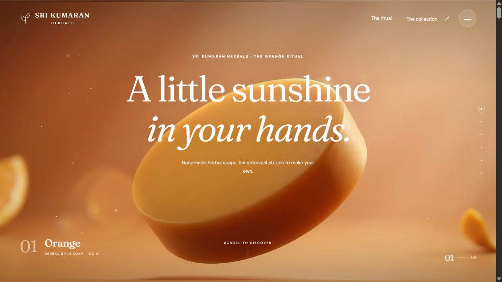
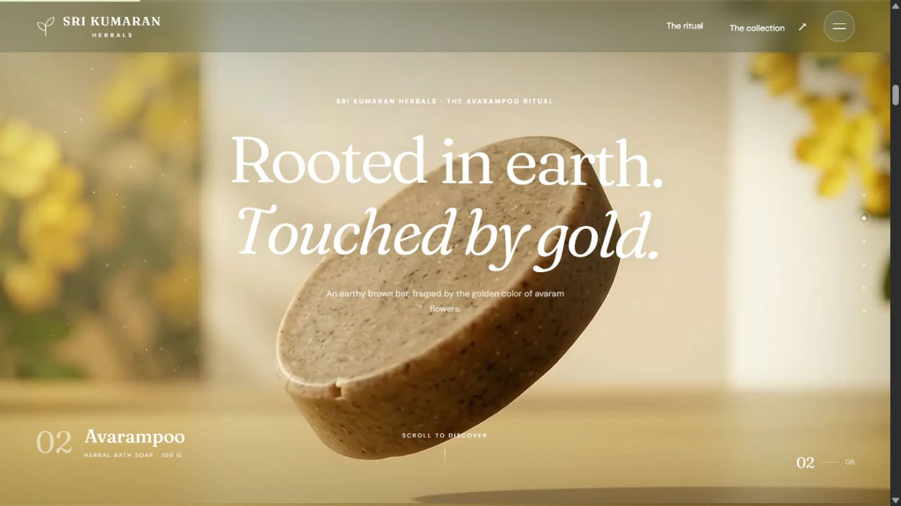
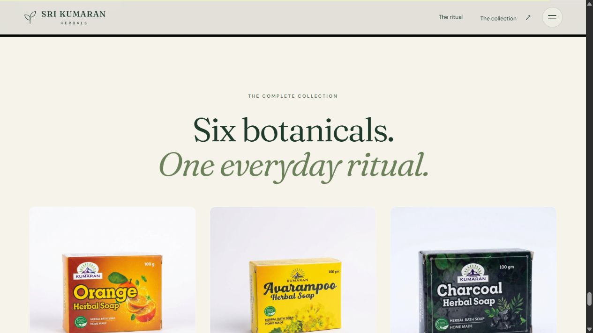
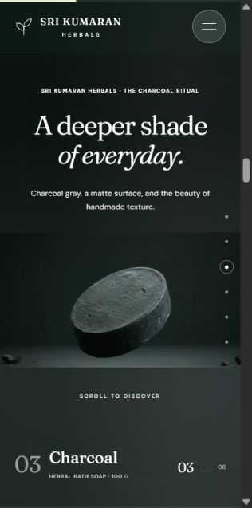

# Sri Kumaran Herbels

### Six botanicals. One everyday ritual.

A responsive product showcase for **Sri Kumaran Herbals**, featuring six handmade herbal soaps through cinematic, scroll-controlled animation. Built with HTML, CSS, and JavaScript, with Node.js tooling for local preview, media preparation, and asset verification.

[](https://github.com/SIVARAJANnn/sri-kumaran-herbels/actions/workflows/verify.yml)



## Features

- **Six botanical stories:** Orange, Avarampoo, Charcoal, Sandalwood, Aloe Vera, and Kuppaimeni.
- **Scroll-controlled canvas animation:** forward and reverse playback, with the current frame held when scrolling stops.
- **Responsive media:** desktop and mobile frame variants, with a shared download queue and bounded decoded-image caches.
- **Accessible navigation:** keyboard focus, Escape-to-close menu, ordinary chapter anchors, and reduced-motion support.
- **Product collection:** original packaging photographs and links back to each soap story.
- **Ready-to-preview assets:** source videos, 12 manifests, and 2,280 WebP frames are included.

## Screenshots

### Botanical chapters



### Product collection



### Mobile experience



Screenshots were captured from the local website. Additional chapter and viewport captures are available in [`soap-scroll-studio/qa/`](soap-scroll-studio/qa/).

## Languages and technology

| Technology | Role |
| --- | --- |
| HTML5 | Semantic page structure, navigation, and accessible landmarks |
| CSS3 | Responsive layouts, typography, transitions, and visual styling |
| JavaScript (ES modules) | Canvas rendering, scroll state, frame scheduling, and client interaction |
| Node.js | Static preview server and media/verification scripts written in JavaScript |
| Canvas 2D API | Rendering decoded animation frames and background colors |
| FFmpeg | Converting supplied MP4 clips into WebP frame sequences |
| JSON | Product data, sequence manifests, media registry, and integrity report |

The client uses browser APIs directly. Its only development dependency is `@ffmpeg-installer/ffmpeg`.

## Run locally

Use **Node.js 22 or later** and Git. The prebuilt website can be previewed immediately:

```sh
git clone https://github.com/SIVARAJANnn/sri-kumaran-herbels.git
cd sri-kumaran-herbels/soap-scroll-studio
npm run dev
```

Open **http://127.0.0.1:4173/**. The preview server binds to localhost and serves `dist/`.

To install media tooling and refresh the original product assets:

```sh
npm ci
```

The npm `prepare` lifecycle refreshes product photographs and metadata while preserving the active media registry. This is a media-rich project: cloning downloads the bundled frame sequences and source videos.

## Development commands

Run these commands from `soap-scroll-studio/`:

| Command | Purpose |
| --- | --- |
| `npm run dev` | Start the local static preview |
| `npm run prepare` | Refresh product photographs, metadata, and reference images |
| `npm run check` | Validate the six-soap mapping, manifests, frames, photographs, and video checksums |
| `npm run check:media` | Exercise MP4-to-WebP conversion using an isolated test fixture |
| `npm run build:frames` | Rebuild all six sequences from the bundled source clips |
| `node --check dist/app.js` | Check browser JavaScript syntax |

For external originals, set `SUPPLIED_VIDEO_DIR` before rebuilding. The build accepts either the original filenames containing their source identifiers or the bundled names such as `orange.mp4`. It creates a fresh batch and updates `dist/media.json` after conversion succeeds.

## Project structure

```text
.
├── docs/screenshots/                 # README preview images
├── SRI KUMARAN HERBALS collection/    # Original product photographs
└── soap-scroll-studio/
    ├── data/                        # Product catalog and source-video mapping
    ├── dist/                        # Ready-to-serve static website
    │   ├── assets/                  # Product photographs
    │   ├── frames/                  # WebP sequences and manifests
    │   ├── app.js                   # Scroll/canvas client
    │   ├── index.html               # Page shell
    │   └── style.css                # Responsive visual design
    ├── qa/                          # Browser verification notes and captures
    ├── references/                  # Individual soap reference photographs
    ├── scripts/                     # Preview, preparation, conversion, and checks
    ├── videos/                      # Archived source clips
    └── supplied-video-report.json   # Source mappings and SHA-256 checksums
```

## How it works

The page loads the product catalog and media registry, chooses a viewport-appropriate manifest, and maps chapter scroll progress to a frame index. A shared queue downloads nearby frames; the canvas renders the selected image. Distant decoded images are released to limit memory use, and adjacent chapters preload their opening frames. Reduced-motion preferences use a static frame.

The active sequences contain 190 frames per soap per variant at 24 fps. Desktop frames are 1920 × 1080; the mobile delivery variant is 1280 × 720. Both retain a 16:9 source composition, with the website adapting the view for narrow screens.

## Deployment and project scope

Deploy **`soap-scroll-studio/dist/`** to a static host at the domain root. Keep the frame directory and JSON registry together; the client uses root-relative asset URLs. Public hosting is not configured by this repository.

This project is a brand presentation and collection browser. Accounts, checkout, payments, and inventory management are future integrations.

## Media and contributions

Product photographs and supplied video clips are included as project assets. The presentation applies a proportional display crop; it does not modify the archived originals or remove invisible provenance metadata. See [media notes](docs/MEDIA.md) and [contribution guidance](CONTRIBUTING.md).

No open-source license has been assigned. Availability on GitHub does not grant permission to reuse the brand, photographs, or video assets.
